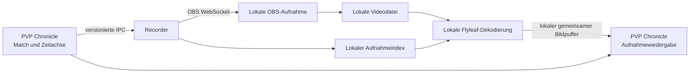

# PVP Chronicle Recorder

[English](README.md) | [简体中文](README.zh-CN.md) | [繁體中文](README.zh-TW.md) | [日本語](README.ja.md) | [한국어](README.ko.md) | [Deutsch](README.de.md) | [Français](README.fr.md)

PVP Chronicle Recorder ist eine optionale lokale Aufnahme-Erweiterung für PVP Chronicle. Sie startet OBS in unterstützten PvP-Inhalten automatisch, verknüpft die lokale Aufnahme mit der Match-Zeitachse und zeigt Video, Karte und Kampfereignisse gemeinsam an.

> [!IMPORTANT]
> Dieses Plugin erkennt Matches nicht selbstständig. PVP Chronicle muss ebenfalls aktiv sein. Aufnahmen bleiben auf diesem PC und werden nicht zum PVP-Chronicle-Server hochgeladen.

## Hauptfunktionen

- Automatischer Aufnahmestart über OBS WebSocket v5 in unterstützten Frontline- und Crystalline-Conflict-Matches.
- Automatisches Beenden nach einem regulären Matchende und Zuordnung über die Match-ID.
- Lokale Wiedergabe direkt im Reiter **Aufnahmewiedergabe** von PVP Chronicle.
- Gemeinsamer Zeitcursor für Video, Replay-Zeitachse und Schlachtfeldkarte.
- Klick zum Starten/Pausieren, ±10 Sekunden, 0,5×–2× Geschwindigkeit und mehrere Anzeigequalitäten.
- Zweispaltige Ansicht: Video links, synchronisierte Karte und Ereignisse rechts.
- Mit Windows DPAPI verschlüsselte Speicherung des OBS-Passworts.
- Flyleaf-Laufzeit wird nur auf Wunsch geladen und vor dem Entpacken anhand Größe und SHA-256 geprüft.

## Schnellstart

1. XIVLauncher installieren und starten; Dalamud aktivieren.
2. **Dalamud-Einstellungen → Experimentell** öffnen.
3. Dieses benutzerdefinierte Repository hinzufügen:

   ```text
   https://raw.githubusercontent.com/chefiffer/dalamud-plugins/main/repo.json
   ```

4. PVP Chronicle und PVP Chronicle Recorder installieren und aktivieren.
5. Den WebSocket-Server in OBS aktivieren und ein Passwort festlegen.
6. Im Spiel `/pvprec` eingeben.
7. OBS-WebSocket-Adresse und Passwort eintragen, speichern und **OBS-Verbindung testen** wählen.
8. Die offizielle Flyleaf-Wiedergabelaufzeit installieren und Download, Prüfung und Entpacken abwarten.
9. OBS geöffnet lassen und ein unterstütztes PvP-Match testen.

Einzelheiten zu Szenen, Zuschnitt, reinem Spielton und Fehlerbehebung stehen in der [OBS-Anleitung](./OBSSetupGuide.de.md).

## Einstellungen

| Option | Empfehlung | Zweck |
| --- | --- | --- |
| Sprache | Automatisch | Systemsprache verwenden oder Recorder-Sprache wählen |
| Automatische Aufnahme | Ein | OBS durch Match-Start und -Ende steuern |
| OBS-WebSocket-Adresse | `ws://127.0.0.1:4455` | Lokale OBS-Verbindung ohne System-Proxy |
| OBS-WebSocket-Passwort | Wie in OBS | Lokale Authentifizierung, DPAPI-verschlüsselt |
| Flyleaf-FFmpeg-Ordner | Installationsknopf verwenden | Lokale Videodekodierung |
| Erstbild-Kalibrierung | `0 ms` | Konstante Abweichung zur Match-Zeitachse korrigieren |

## Aufnahme und Wiedergabe



Die Plugins tauschen über versionierte IPC nur Match-ID, Zeit und Wiedergabestatus aus. Videobilder gelangen über einen lokalen gemeinsamen Puffer in die ImGui-Textur von PVP Chronicle und niemals ins Netzwerk. Es handelt sich nicht um ein überlagertes Fremdfenster.

## Bedienung

- Video anklicken: Start/Pause.
- `-10s` / `+10s`: Video, Karte und Replay gemeinsam verschieben.
- **An aktuelle Replay-Zeit anpassen**: Video zur gewählten Replay-Zeit springen lassen.
- Geschwindigkeit: 0,5×, 1×, 1,5×, 2×.
- Qualität: Flüssig, HD, Klar und Original; Standard ist Original.
- Beim Verlassen des Reiters oder Schließen des Fensters pausiert die Wiedergabe samt Ton.

## Lokale Daten und Datenschutz

| Daten | Speicherort | Server-Upload |
| --- | --- | --- |
| OBS-Aufnahmen | In OBS gewählter Ordner | Nein |
| Match-Zuordnung | Dalamud-Konfigurationsordner | Nein |
| OBS-Passwort | Dalamud-Konfiguration, DPAPI-verschlüsselt | Nein |
| Flyleaf-FFmpeg | Recorder-Konfigurationsordner | Nein |
| Matchanalyse | Nach den Regeln von PVP Chronicle | Nicht durch Recorder |

## Bekannte Grenzen

- Bei Absturz oder erzwungenem Ende fehlt eventuell das Match-Ende; automatisches Stoppen und Zuordnen ist dann nicht garantiert.
- Aufnahmen vor und nach einem Absturz werden nicht automatisch verbunden; das nächste Match erhält eine eigene Datei.
- Nach Verschieben oder Löschen einer OBS-Datei bleibt der Verlauf, aber das Video ist nicht abspielbar.
- Ohne Recorder funktionieren Erfassung und normale Replays von PVP Chronicle weiter.
- Ohne PVP Chronicle erhält Recorder keine Match-Ereignisse.

## Drittanbieter

- [Flyleaf](https://github.com/SuRGeoNix/Flyleaf): lokale Dekodierung und Wiedergabe.
- [FFmpeg](https://ffmpeg.org/): Teil der offiziellen Flyleaf-Laufzeit.
- [SharpCompress](https://github.com/adamhathcock/sharpcompress): Entpacken der geprüften Laufzeit.

Lizenzen und Quellen: [THIRD-PARTY-NOTICES.md](./THIRD-PARTY-NOTICES.md).
