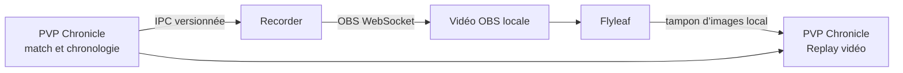

# PVP Chronicle Recorder

[English](README.md) | [简体中文](README.zh-CN.md) | [繁體中文](README.zh-TW.md) | [日本語](README.ja.md) | [한국어](README.ko.md) | [Deutsch](README.de.md) | [Français](README.fr.md)

PVP Chronicle Recorder est le compagnon local facultatif de PVP Chronicle : il commande OBS dans les matchs JcJ pris en charge, associe la vidéo locale à la chronologie et affiche ensemble vidéo, carte et événements.

> [!IMPORTANT]
> Il ne détecte pas seul les matchs : PVP Chronicle doit être activé. Les vidéos restent sur ce PC et ne sont jamais envoyées au serveur.

## Fonctions principales

- Démarrage et arrêt automatiques via OBS WebSocket v5, puis association par identifiant de match.
- Lecture locale dans l’onglet **Replay vidéo**, sans lecteur externe.
- Synchronisation vidéo, chronologie et carte ; clic lecture/pause, ±10 s, 0,5×–2× et plusieurs qualités.
- Mise en page à deux colonnes, mot de passe OBS chiffré par DPAPI et runtime Flyleaf vérifié par taille et SHA-256.

## Démarrage rapide

1. Installer XIVLauncher et activer Dalamud.
2. Dans **Paramètres Dalamud → Expérimental**, ajouter :

   ```text
   https://raw.githubusercontent.com/chefiffer/dalamud-plugins/main/repo.json
   ```

3. Installer et activer PVP Chronicle et PVP Chronicle Recorder.
4. Activer OBS WebSocket et définir un mot de passe.
5. Saisir `/pvprec`, renseigner `ws://127.0.0.1:4455` et le mot de passe, enregistrer et tester.
6. Installer le runtime officiel Flyleaf, garder OBS ouvert et tester un match pris en charge.

Voir le [guide OBS](./OBSSetupGuide.fr.md) pour les scènes, le recadrage, l’audio et le dépannage.

## Réglages

| Option | Valeur conseillée | Rôle |
| --- | --- | --- |
| Langue | Auto | Suivre le système ou choisir la langue du Recorder |
| Enregistrement automatique | Activé | Commander OBS aux événements début/fin |
| Adresse OBS | `ws://127.0.0.1:4455` | Connexion locale sans proxy système |
| Mot de passe OBS | Identique à OBS | Authentification locale, chiffrée DPAPI |
| Dossier Flyleaf FFmpeg | Bouton d’installation | Décodage local |
| Étalonnage première image | `0 ms` | Corriger un décalage fixe |

## Flux et commandes



Seuls l’identifiant, le temps et l’état de lecture passent par IPC ; aucun pixel ne quitte le PC. Cliquez la vidéo pour lecture/pause, utilisez `-10s` / `+10s`, l’alignement au temps du replay, les vitesses 0,5× à 2× et les qualités Fluide, HD, Nette ou Originale. Quitter l’onglet interrompt aussi le son.

## Données locales et limites

Les vidéos OBS, l’index d’association, le mot de passe chiffré et FFmpeg restent locaux. Un plantage peut empêcher l’arrêt et l’association automatiques ; les segments avant/après plantage ne sont pas fusionnés. Déplacer ou supprimer une vidéo rend son replay indisponible sans supprimer l’historique. Recorder et PVP Chronicle peuvent être désactivés indépendamment, mais l’enregistrement automatique exige PVP Chronicle.

Composants : [Flyleaf](https://github.com/SuRGeoNix/Flyleaf), [FFmpeg](https://ffmpeg.org/) et [SharpCompress](https://github.com/adamhathcock/sharpcompress). Licences : [THIRD-PARTY-NOTICES.md](./THIRD-PARTY-NOTICES.md).
