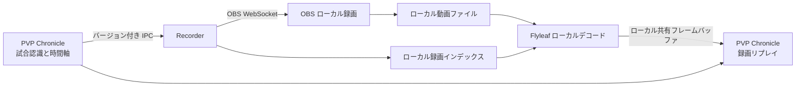

# PVP Chronicle Recorder

[English](README.md) | [简体中文](README.zh-CN.md) | [繁體中文](README.zh-TW.md) | [日本語](README.ja.md) | [한국어](README.ko.md) | [Deutsch](README.de.md) | [Français](README.fr.md)

PVP Chronicle Recorder は、PVP Chronicle 用の任意導入のローカル録画プラグインです。対応 PvP コンテンツに入ると OBS で自動録画し、録画ファイルを試合タイムラインに関連付け、動画・マップ・戦闘イベントを同じリプレイ画面で確認できます。

> [!IMPORTANT]
> 本プラグイン単体では試合を認識できません。PVP Chronicle も有効にしてください。録画ファイルはこの PC のみに保存され、PVP Chronicle サーバーへ送信されません。

## 主な機能

- 対応するフロントラインまたはクリスタルコンフリクトに入ると、OBS WebSocket v5 経由で録画を開始します。
- 正常終了時に録画を停止し、試合 ID で該当リプレイへ関連付けます。
- 外部プレイヤーを使わず、PVP Chronicle の「録画リプレイ」タブでローカル動画を再生します。
- 動画、リプレイ時間軸、戦場マップを同一の時刻カーソルに同期します。
- 画面クリックによる再生・一時停止、10 秒移動、0.5×～2×速度、複数の表示画質に対応します。
- 左側に動画、右側に同期マップと現在時刻のイベントを表示する 2 列構成です。
- OBS パスワードは現在の Windows ユーザーの DPAPI で暗号化して保存します。
- Flyleaf 再生ランタイムは必要時のみダウンロードし、展開前に固定サイズと SHA-256 を検証します。

## クイックスタート

1. XIVLauncher をインストールして起動し、Dalamud が有効であることを確認します。
2. **Dalamud 設定 → 試験的機能**を開きます。
3. 次のカスタムプラグインリポジトリを追加します。

   ```text
   https://raw.githubusercontent.com/chefiffer/dalamud-plugins/main/repo.json
   ```

4. プラグインインストーラーで PVP Chronicle と PVP Chronicle Recorder をインストールし、有効化します。
5. OBS の WebSocket サーバーを有効にしてパスワードを設定します。
6. ゲーム内チャットで次を入力します。

   ```text
   /pvprec
   ```

7. OBS WebSocket のアドレスとパスワードを入力・保存し、「OBS 接続をテスト」を押します。
8. 「公式 Flyleaf 再生ランタイムをインストール」を押し、ダウンロード、検証、展開の完了を待ちます。
9. OBS を起動したまま対応 PvP コンテンツへ入り、動作を確認します。

OBS シーン、クロップ、ゲーム音声のみの録音、トラブル対処は [OBS 設定ガイド](./OBS使用教程.ja.md) を参照してください。

## 設定

| 項目 | 推奨値 | 用途 |
| --- | --- | --- |
| 表示言語 | 自動 | OS の言語に従うか Recorder 専用言語を選択 |
| 自動録画 | 有効 | PVP Chronicle の試合開始・終了イベントで OBS を制御 |
| OBS WebSocket アドレス | `ws://127.0.0.1:4455` | 同じ PC の OBS に接続。ループバックはシステムプロキシを経由しません |
| OBS WebSocket パスワード | OBS と同じ | ローカル接続を認証し、DPAPI で暗号化保存 |
| Flyleaf FFmpeg フォルダー | インストールボタンで自動設定 | ローカル動画のデコードに使用 |
| 先頭フレーム補正 | `0 ms` | 動画先頭と試合時間軸の一定のずれを補正 |

## 録画と再生の流れ



両プラグインがバージョン付き IPC で交換するのは、試合 ID、時刻、再生状態だけです。動画ピクセルはローカル共有フレームバッファから PVP Chronicle の ImGui テクスチャへ渡され、ネットワークには送信されません。別ウィンドウをリプレイ画面に重ねる方式でもありません。

## 再生操作

- 動画をクリック：再生または一時停止。
- `-10s` / `+10s`：動画、マップ、リプレイ時刻を同時に前後移動。
- 「現在のリプレイ時刻に合わせる」：動画を選択中のリプレイ時刻へ移動。
- 速度：0.5×、1×、1.5×、2×。
- 画質：スムーズ、高画質、鮮明、オリジナル。既定はオリジナルです。
- タブを離れるかリプレイ画面を閉じると自動的に一時停止し、音声がバックグラウンドで流れ続けません。

## ローカルデータとプライバシー

| データ | 保存場所 | サーバー送信 |
| --- | --- | --- |
| OBS 録画 | OBS で指定した録画フォルダー | なし |
| 試合と録画の関連情報 | Dalamud プラグイン設定フォルダー | なし |
| OBS WebSocket パスワード | Dalamud 設定内、DPAPI 暗号化 | なし |
| Flyleaf FFmpeg ランタイム | Recorder 設定フォルダー | なし |
| 試合分析データ | PVP Chronicle 独自の規則で処理 | Recorder は送信しません |

## 既知の制限

- ゲームがクラッシュまたは強制終了すると終了イベントを受信できず、自動停止と関連付けを保証できません。
- クラッシュ前後の複数動画は自動結合しません。次の試合は別の録画になります。
- OBS 録画を移動・削除すると戦績は残りますが、動画は開けません。
- Recorder を無効化しても PVP Chronicle の収集と通常リプレイには影響しません。
- PVP Chronicle が無効な場合、Recorder は試合イベントを受信できず自動録画しません。

## サードパーティーコンポーネント

- [Flyleaf](https://github.com/SuRGeoNix/Flyleaf)：ローカル動画のデコードと再生。
- [FFmpeg](https://ffmpeg.org/)：Flyleaf 公式ランタイムから提供。
- [SharpCompress](https://github.com/adamhathcock/sharpcompress)：検証済みランタイム書庫の展開。

ライセンスと出典は [THIRD-PARTY-NOTICES.md](./THIRD-PARTY-NOTICES.md) を参照してください。
