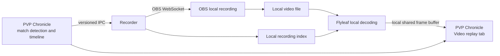

# PVP Chronicle Recorder

[English](README.md) | [简体中文](docs/translations/README.zh-CN.md) | [繁體中文](docs/translations/README.zh-TW.md) | [日本語](docs/translations/README.ja.md) | [한국어](docs/translations/README.ko.md) | [Deutsch](docs/translations/README.de.md) | [Français](docs/translations/README.fr.md)

PVP Chronicle Recorder is an optional local recording companion for PVP Chronicle. It automatically records supported PvP matches through OBS, links the local video to the match timeline, and lets you review the video, map, and combat events together.

> [!IMPORTANT]
> This plugin cannot identify matches by itself. PVP Chronicle must also be enabled. Recordings remain on your computer and are never uploaded to the PVP Chronicle server.

## Features

- Automatically starts recording through OBS WebSocket v5 when you enter a supported Frontline or Crystalline Conflict match.
- Stops recording after a normal result screen and links the video to the replay using the match ID.
- Plays local recordings directly in PVP Chronicle's **Video replay** tab without an external player.
- Keeps the video, replay timeline, and battlefield map on the same time cursor.
- Supports click-to-play/pause, 10-second seeking, 0.5×–2× playback speed, and multiple display-quality levels.
- Uses a two-column replay layout: video on the left, synchronized map and current events on the right.
- Encrypts the OBS password with Windows DPAPI for the current Windows user.
- Downloads the Flyleaf playback runtime only when requested and verifies its fixed size and SHA-256 before extraction.

## Quick start

1. Install and start XIVLauncher, and make sure Dalamud is enabled.
2. Open **Dalamud Settings → Experimental**.
3. Add this custom plugin repository:

   ```text
   https://raw.githubusercontent.com/chefiffer/dalamud-plugins/main/repo.json
   ```

4. Open the plugin installer, then install and enable PVP Chronicle and PVP Chronicle Recorder.
5. Enable the WebSocket server in OBS and set a password.
6. Enter this command in game chat:

   ```text
   /pvprec
   ```

7. Enter the OBS WebSocket address and password, save, and select **Test OBS connection**.
8. Select **Install official Flyleaf playback runtime** and wait for download, verification, and extraction to finish.
9. Keep OBS running and enter a supported PvP match to test the setup.

For OBS scenes, cropping, game-only audio, and troubleshooting, see the [OBS setup guide](docs/obs/OBSSetupGuide.en.md).

## Settings

| Setting | Recommended value | Purpose |
| --- | --- | --- |
| Interface language | Auto | Follow the system language or select a Recorder-specific language |
| Automatic recording | Enabled | Control OBS when PVP Chronicle reports match start and end events |
| OBS WebSocket address | `ws://127.0.0.1:4455` | Connect to OBS on the same computer; loopback bypasses the system proxy |
| OBS WebSocket password | Same as OBS | Authenticate the local WebSocket connection; stored with DPAPI encryption |
| Flyleaf FFmpeg folder | Configure with the install button | Provide local video decoding |
| First-frame calibration | `0 ms` | Correct a fixed offset between the first video frame and match timeline |

## Recording and replay flow



The two plugins exchange only the match ID, time, and playback state through versioned IPC. Video pixels enter PVP Chronicle's ImGui texture through a local shared frame buffer. They are never sent over the network, and the player is not a separate window overlaid on the replay page.

## Replay controls

- Click the video: play or pause.
- `-10s` / `+10s`: move the video, map, and replay time backward or forward together.
- **Align to current replay time**: seek the video to the currently selected replay time.
- Speed: 0.5×, 1×, 1.5×, and 2×.
- Quality: Smooth, HD, Clear, and Original; Original is the default.
- Leaving the Video replay tab or closing the replay window pauses playback so audio does not continue in the background.

## Local data and privacy

| Data | Storage location | Uploaded to server |
| --- | --- | --- |
| OBS recordings | Recording folder configured in OBS | No |
| Match-to-recording index | Dalamud plugin configuration folder | No |
| OBS WebSocket password | Dalamud plugin configuration, DPAPI-encrypted | No |
| Flyleaf FFmpeg runtime | Recorder plugin configuration folder | No |
| Match analysis data | Processed under PVP Chronicle's own rules | Recorder does not upload it |

## Known limitations

- If the game crashes or is forcibly closed, PVP Chronicle may not receive a normal match-end event, so automatic stop and association cannot be guaranteed.
- Recordings made before and after a crash are not automatically joined. The next match creates a separate recording.
- If an OBS recording is moved or deleted, the match history remains, but its replay cannot be opened.
- Disabling Recorder does not affect PVP Chronicle collection or ordinary replays.
- Recorder cannot start automatically without PVP Chronicle because it receives no match events.

## Third-party components

- [Flyleaf](https://github.com/SuRGeoNix/Flyleaf): local video decoding and playback.
- [FFmpeg](https://ffmpeg.org/): supplied by the official Flyleaf runtime.
- [SharpCompress](https://github.com/adamhathcock/sharpcompress): extracts the verified runtime archive.

See [THIRD-PARTY-NOTICES.md](./THIRD-PARTY-NOTICES.md) for licenses and sources.
