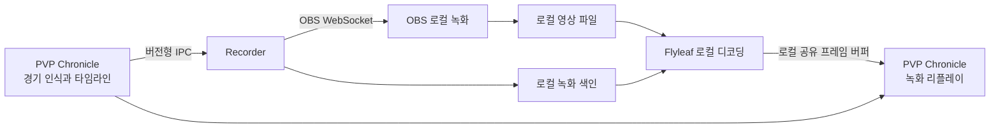

# PVP Chronicle Recorder

[English](../../README.md) | [简体中文](README.zh-CN.md) | [繁體中文](README.zh-TW.md) | [日本語](README.ja.md) | [한국어](README.ko.md) | [Deutsch](README.de.md) | [Français](README.fr.md)

PVP Chronicle Recorder는 PVP Chronicle용 선택형 로컬 녹화 플러그인입니다. 지원되는 PvP 전장에 입장하면 OBS로 자동 녹화하고, 로컬 영상을 경기 타임라인에 연결하여 영상·지도·전투 이벤트를 함께 확인할 수 있습니다.

> [!IMPORTANT]
> 이 플러그인만으로는 경기를 인식할 수 없습니다. PVP Chronicle도 함께 활성화해야 합니다. 녹화 파일은 이 PC에만 저장되며 PVP Chronicle 서버로 업로드되지 않습니다.

## 주요 기능

- 지원되는 전장 또는 크리스탈라인 컨플릭트 입장 시 OBS WebSocket v5로 자동 녹화를 시작합니다.
- 정상 종료 시 녹화를 중지하고 경기 ID로 해당 리플레이와 연결합니다.
- 외부 플레이어 없이 PVP Chronicle의 **녹화 리플레이** 탭에서 로컬 영상을 재생합니다.
- 영상, 리플레이 타임라인, 전장 지도를 같은 시간 커서에 동기화합니다.
- 화면 클릭 재생/일시정지, 10초 이동, 0.5×–2× 속도, 여러 표시 화질을 지원합니다.
- 왼쪽에는 영상, 오른쪽에는 동기화된 지도와 현재 이벤트를 표시합니다.
- OBS 비밀번호는 현재 Windows 사용자의 DPAPI로 암호화하여 저장합니다.
- Flyleaf 재생 런타임은 필요할 때만 내려받고 압축 해제 전에 크기와 SHA-256을 검증합니다.

## 빠른 시작

1. XIVLauncher를 설치·실행하고 Dalamud가 활성화되어 있는지 확인합니다.
2. **Dalamud 설정 → 실험 기능**을 엽니다.
3. 다음 사용자 플러그인 저장소를 추가합니다.

   ```text
   https://raw.githubusercontent.com/chefiffer/dalamud-plugins/main/repo.json
   ```

4. 플러그인 설치기에서 PVP Chronicle과 PVP Chronicle Recorder를 설치하고 활성화합니다.
5. OBS WebSocket 서버를 활성화하고 비밀번호를 설정합니다.
6. 게임 채팅에 다음을 입력합니다.

   ```text
   /pvprec
   ```

7. OBS WebSocket 주소와 비밀번호를 입력·저장한 뒤 **OBS 연결 테스트**를 누릅니다.
8. **공식 Flyleaf 재생 런타임 설치**를 누르고 다운로드, 검증, 압축 해제를 기다립니다.
9. OBS를 켠 상태로 지원되는 PvP 경기에 입장하여 테스트합니다.

OBS 장면, 자르기, 게임 소리만 녹음하기 및 문제 해결은 [OBS 설정 안내서](../obs/OBSSetupGuide.ko.md)를 참고하세요.

## 설정

| 항목 | 권장값 | 용도 |
| --- | --- | --- |
| 인터페이스 언어 | 자동 | 시스템 언어를 따르거나 Recorder 언어를 직접 선택 |
| 자동 녹화 | 켬 | PVP Chronicle의 경기 시작·종료 이벤트로 OBS 제어 |
| OBS WebSocket 주소 | `ws://127.0.0.1:4455` | 같은 PC의 OBS에 연결하며 시스템 프록시를 우회 |
| OBS WebSocket 비밀번호 | OBS와 동일 | 로컬 연결 인증, DPAPI 암호화 저장 |
| Flyleaf FFmpeg 폴더 | 설치 버튼으로 자동 설정 | 로컬 영상 디코딩 |
| 첫 프레임 보정 | `0 ms` | 영상 첫 프레임과 경기 타임라인의 고정 오차 보정 |

## 녹화와 재생 흐름



두 플러그인은 버전형 IPC로 경기 ID, 시간, 재생 상태만 교환합니다. 영상 픽셀은 로컬 공유 프레임 버퍼를 통해 PVP Chronicle의 ImGui 텍스처로 전달되며 네트워크로 전송되지 않습니다. 별도 창을 리플레이 위에 덮는 방식도 아닙니다.

## 재생 조작

- 영상을 클릭하면 재생/일시정지합니다.
- `-10s` / `+10s`는 영상, 지도, 리플레이 시간을 함께 이동합니다.
- **현재 리플레이 시간에 맞추기**는 영상을 선택된 리플레이 시간으로 이동합니다.
- 속도: 0.5×, 1×, 1.5×, 2×.
- 화질: 원활, HD, 선명, 원본. 기본은 원본입니다.
- 탭을 벗어나거나 창을 닫으면 자동 일시정지되어 소리가 백그라운드에서 계속 재생되지 않습니다.

## 로컬 데이터와 개인정보

| 데이터 | 저장 위치 | 서버 업로드 |
| --- | --- | --- |
| OBS 녹화 | OBS에서 지정한 폴더 | 아니요 |
| 경기-녹화 연결 색인 | Dalamud 플러그인 설정 폴더 | 아니요 |
| OBS WebSocket 비밀번호 | Dalamud 설정, DPAPI 암호화 | 아니요 |
| Flyleaf FFmpeg 런타임 | Recorder 설정 폴더 | 아니요 |
| 경기 분석 데이터 | PVP Chronicle 규칙으로 처리 | Recorder는 업로드하지 않음 |

## 알려진 제한

- 게임 충돌·강제 종료 시 정상 종료 이벤트가 없어 자동 중지와 연결을 보장할 수 없습니다.
- 충돌 전후 영상은 자동으로 합치지 않으며 다음 경기는 별도 영상입니다.
- OBS 영상을 이동하거나 삭제하면 전적은 남지만 영상은 열 수 없습니다.
- Recorder를 꺼도 PVP Chronicle의 수집과 일반 리플레이는 영향을 받지 않습니다.
- PVP Chronicle이 꺼져 있으면 경기 이벤트가 없어 자동 녹화하지 않습니다.

## 타사 구성 요소

- [Flyleaf](https://github.com/SuRGeoNix/Flyleaf): 로컬 영상 디코딩과 재생.
- [FFmpeg](https://ffmpeg.org/): Flyleaf 공식 런타임에서 제공.
- [SharpCompress](https://github.com/adamhathcock/sharpcompress): 검증된 런타임 압축 파일 해제.

라이선스와 출처는 [THIRD-PARTY-NOTICES.md](../../THIRD-PARTY-NOTICES.md)를 참고하세요.
